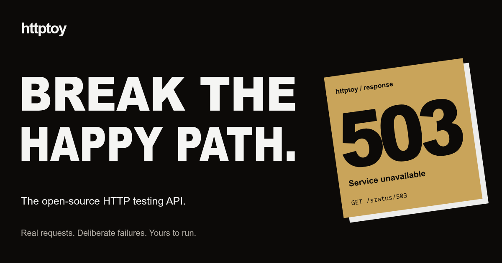

<p align="center">
  <strong>A playground for the beautifully broken side of HTTP.</strong><br />
  Real requests. Deliberate failures. Yours to run.
</p>

<p align="center">
  <a href="https://httptoy.com">Live playground</a> ·
  <a href="docs/REFERENCE.md#api-endpoints">API reference</a> ·
  <a href="LICENSE">MIT license</a>
</p>

## 🐳 Run with Docker

No clone. No build. Just the image from [Docker Hub](https://hub.docker.com/r/mayankfawkes/httptoy).

```sh
docker run -d --pull always --name httptoy \
  -p 127.0.0.1:8000:8000 \
  mayankfawkes/httptoy:2
```

Open **http://localhost:8000**.

<details>
<summary>⚡ Prefer Docker Compose?</summary>

Save as `compose.yaml`:

```yaml
services:
  httptoy:
    image: mayankfawkes/httptoy:2
    ports:
      - "127.0.0.1:8000:8000"
    environment:
      PUBLIC_URL: "${PUBLIC_URL:-http://localhost:8000}"
    restart: unless-stopped
```

```sh
docker compose up -d
```

</details>

Version `2` tracks stable v2 releases; use an exact tag such as `2.0.0` to pin a release.

<details>
<summary>📦 Prefer a standalone binary?</summary>

Download your OS/CPU binary from [GitHub Releases](https://github.com/TrueFix/httptoy/releases).
The frontend is included—no Docker, Go, or Node installation needed.

On Linux/macOS, rename the download to `httptoy`, then run:

```sh
chmod +x httptoy
./httptoy
```

On Windows, download the matching `.exe` and run it. Open **http://localhost:8000**.
Verify downloads against the release's `SHA256SUMS` before renaming or running them.

</details>

## 🧪 Give your client a bad day

Inspect requests, simulate failures, capture webhooks, test retries, and stream
responses. Built-in **OpenAPI**, **Postman collections**, and **Prometheus metrics**.

```sh
# See what you sent
curl 'http://localhost:8000/anything?hello=world'

# Fail on purpose
curl -i http://localhost:8000/status/503

# Make your client back off
curl -i http://localhost:8000/retry-after/5

# Keep the conversation going
curl -N 'http://localhost:8000/sse?count=3'
```

[Explore all endpoints →](docs/REFERENCE.md#api-endpoints)

## 🛠️ Make it yours

**Go + Gorilla mux** on the backend. **React + Vite + Framer Motion** up front.

[Frontend development](docs/REFERENCE.md#frontend-development) ·
[Tests](docs/REFERENCE.md#backend-checks) ·
[Deployment & limits](docs/REFERENCE.md#limits-and-deployment) ·
[Releases](docs/REFERENCE.md#releases)

> Use synthetic data only. For remote deployments, configure TLS, access controls,
> and `PUBLIC_URL`. [Deployment notes →](docs/REFERENCE.md#limits-and-deployment)
